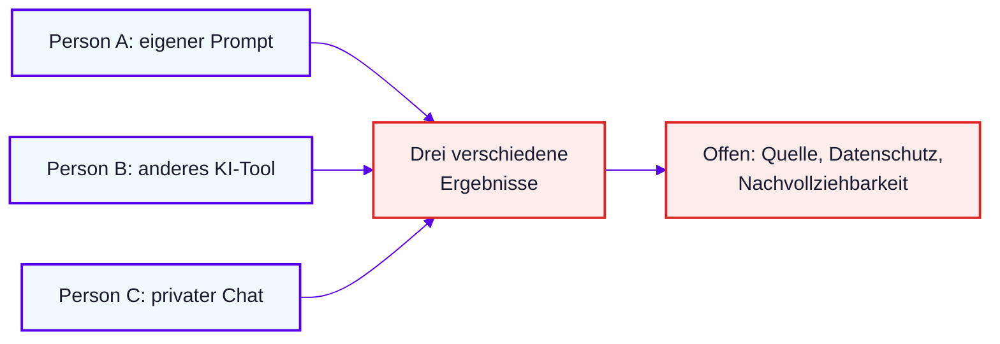
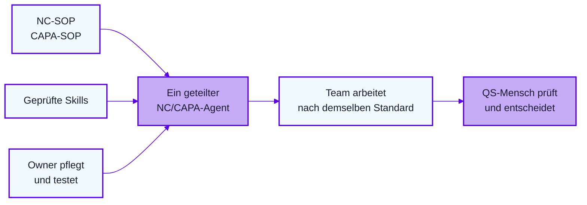
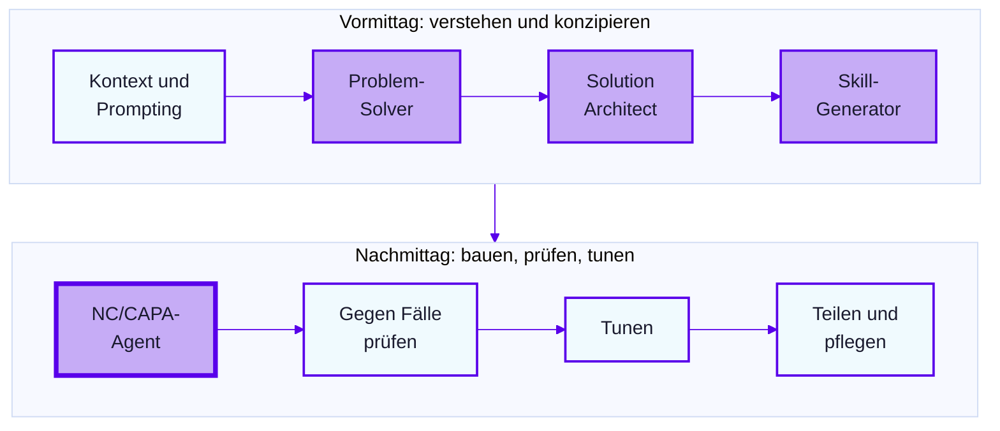

# Lab 1.1: Vom KI-Wildwuchs zum Agenten

**Leitfragen:**

<details>
<summary>Wofür wird KI im Team heute genutzt?</summary>

Meist individuell: eigener Prompt, eigenes Tool, privater Chat. Das ist die Ausgangslage, die als KI-Wildwuchs bezeichnet wird.

</details>

<details>
<summary>Was weiß Copilot über die NC-SOP, wenn niemand sie mitgibt?</summary>

Nichts Nordwind-Spezifisches. Ohne SOP entstehen plausible, aber erfundene Kriterien (siehe Live-Vergleich in Lab 1.2).

</details>

<details>
<summary>Was wäre gewonnen, wenn ein Agent jeden neuen Fall nach demselben Muster vorbereitet?</summary>

Gleiche Quellen, gleiche Regeln, benannte Verantwortung. Das Team arbeitet nach demselben Standard, der Mensch prüft und entscheidet.

</details>

- KI-Wildwuchs: viel Nutzung, kein Standard, keine Verantwortung.
- Ein geteilter Agent ersetzt den Wildwuchs durch gleiche Quellen, geprüfte Skills und einen Owner.
- Der Hebel entsteht durch Rolle, Kontext, Dokumente und Ablauf, nicht durch das Tool.

## Ausgangslage: KI-Wildwuchs

Jede Person nutzt KI anders. Bei NC und CAPA ist das ein Qualitätsrisiko, weil Quelle, Datenschutz und Nachvollziehbarkeit offen bleiben.



## Der Standard: ein geteilter Agent

Ein Agent bündelt SOPs, Skills und Pflege an einer Stelle. Das Ergebnis bleibt ein Vorschlag, die Entscheidung liegt beim QS-Team.



## Die Hebel-Leiter

Jede Stufe gibt Copilot mehr von dem mit, was für eine prozesskonforme Antwort nötig ist. Beispiel NC-02 (Stückzahl 201 statt 200):

| Stufe | Was dazukommt | Beispiel am Fall NC-02 |
| --- | --- | --- |
| 1 Frage | nichts | „Was soll ich tun?“, generische Antwort |
| 2 Rolle und Kontext | wer, wofür, für welchen Prozess | Rolle QS-Mitarbeitende nach Nordwind-NC-SOP |
| 3 Dokumente | SOP und Fall als Quelle | NC-SOP und Meldung NC-02 angehängt |
| 4 Ketten | jeder Schritt nutzt das Ergebnis des vorherigen | Problembeschreibung, dann Aufgabenplan, dann CAPA-Hinweis |
| 5 Agent | Rolle, Quellen und Ablauf dauerhaft gespeichert | Nordwind-NC/CAPA-Assistent, im Team geteilt |

## Live-Vergleich: NC-02 zweimal an Copilot Chat

Eingabe beider Läufe ist die Erstmeldung [`nc-02-stueckzahl-part1-eingang.docx`](../../project/faelle/nc-02-stueckzahl-part1-eingang.docx) (Soll 200 Stück laut Fertigungsauftrag, Ist 201 Stück laut Ausführungsprotokoll des Dienstleisters).

| | Prompt A | Prompt B |
| --- | --- | --- |
| Eingabe | nur die Meldung | Rolle, SOP-Auszug, Meldung, Ausgabeformat |
| Wortlaut | „Was soll ich tun?“ | siehe Codeblock |
| Ergebnis | allgemeine Tipps, kein Bezug zur SOP | Antwort im SOP-Aufbau, mit Quellenbezug |

```text
Du bist QS-Mitarbeitende bei Nordwind Medical und arbeitest nach der angehängten NC-SOP.
Bereite die angehängte Meldung NC-02 vor: Problembeschreibung nach Abschnitt A4.4.
Nutze nur Meldung und SOP, nenne zu jeder Aussage die Quelle.
Format: Tabelle Soll, Ist, Differenz, Ort, Zeit, Objekt, Umfang, Entdeckung, Historie.
```

Danach läuft der fertige Nordwind-NC/CAPA-Agent am selben Fall. Rolle, SOPs und Skills sind dort hinterlegt, die Eingabe besteht nur aus der Meldung. Dieser Agent entsteht in Modul 2 und 3.

## Zielbild des Tages: KI nutzen, um KI zu bauen

Vormittags konzipieren drei Assistenten den Agenten, nachmittags wird er zusammengesetzt, an Fällen geprüft und getunt.



## Fazit

- Wildwuchs ist ein Prozessproblem: ohne gemeinsame Quelle und Verantwortung ist kein Ergebnis nachvollziehbar.
- Die Hebel-Leiter führt von der Einzelfrage zum dauerhaft gespeicherten Agenten.
- Dieselbe Meldung liefert mit Rolle, SOP und Format eine andere, prüfbare Antwort.
