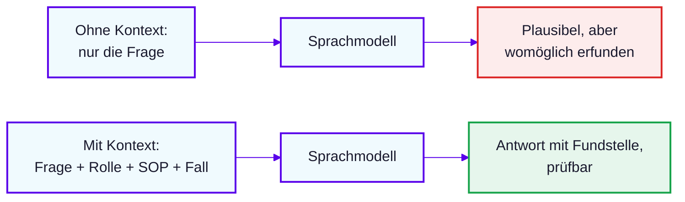

# Lab 1.2: Wie KI lernt und Wissen speichert

**Leitfragen:**

Woher „weiß“ ein Sprachmodell etwas?

Aus Mustern im Training, gespeichert als Gewichte. Es schlägt nichts nach, es rechnet Wahrscheinlichkeiten.

Warum klingt eine erfundene Antwort genauso sicher wie eine richtige?

Das Modell erzeugt immer flüssigen Text. Sicherheit im Ton sagt nichts über Richtigkeit.

Was ändert ein angehängtes Dokument an der Antwort?

Die Antwort stützt sich auf die Quelle und lässt sich dagegen prüfen. Das Modell muss nicht raten.

- KI ist der Oberbegriff, ein LLM ist ein Sprachmodell darin.
- Wissen steckt als Gewichte und Verbindungen in Parametern, nicht in einer abfragbaren Datenbank.
- Der Kontext aktiviert die passenden Verbindungen. Fehlt er, ergänzt das Modell Wahrscheinliches.

## KI ist nicht gleich LLM

| Begriff | Bedeutung |
| --- | --- |
| KI | Oberbegriff für Systeme, die Aufgaben lösen, die sonst Denken erfordern |
| LLM | Sprachmodell, das Text erzeugt, indem es das wahrscheinlichste nächste Token vorhersagt |
| Generative KI | erzeugt neue Inhalte: eine Wahrscheinlichkeitsmaschine, keine Wahrheitsmaschine |

Ein Token ist ein Textbaustein (Wort oder Wortteil), den das Modell als Einheit verarbeitet.

## Wie KI lernt

| Lernart | Prinzip | QS-Beispiel |
| --- | --- | --- |
| Überwacht | Beispiele mit bekannter Lösung | Meldungen, die jemand als NC oder Nicht-NC eingestuft hat |
| Unüberwacht | Muster ohne vorgegebene Lösung | Häufungen in einer NC-Liste erkennen |
| Bestärkend | Belohnung und Strafe, auch durch Menschen | Bewertung von Antworten durch Menschen schärft das Modell |

## Wissen im Modell: Datenbank oder Parameter?

| | Datenbank | Sprachmodell |
| --- | --- | --- |
| Speicherung | Fakten stehen an einer Stelle | Gewichte und Verbindungen in Parametern |
| Abfrage | liefert genau den Eintrag | Kontext aktiviert die passenden Verbindungen |
| Nicht vorhanden | keine Antwort | Modell ergänzt Wahrscheinliches (Halluzination) |

Folge für die QS: Eine Zahl, ein Datum oder ein SOP-Abschnitt aus dem Modell ist nie eine Fundstelle. Belegt ist nur, was in der mitgegebenen Quelle steht.

## Kontext ist alles

## Live-Vergleich: dieselbe SOP-Frage ohne und mit SOP

Frage in beiden Läufen: „Wann ist eine Abweichung eine CAPA?“ Mit SOP ist [`nordwind-sop-nc.md`](../../project/sop/nordwind-sop-nc.md) angehängt; die Kriterien stehen dort in Abschnitt A4.9.

| | Ohne SOP | Mit angehängter SOP |
| --- | --- | --- |
| Inhalt | plausible, aber erfundene Kriterien | Antwort aus den Nordwind-Kriterien |
| Ton | klingt genauso sicher wie eine richtige Antwort | Abschnitt der SOP wird genannt |
| Prüfbarkeit | nicht prüfbar | der Satz steht im Dokument |

## Fazit

- Ein Sprachmodell schlägt nicht nach, es berechnet das wahrscheinlichste nächste Token.
- Sicherer Ton ist kein Qualitätsmerkmal: Prüfbar ist nur, was eine Fundstelle in der mitgegebenen Quelle hat.
- Kontext (Rolle, SOP, Fall) ist der wirksamste Hebel für prozesskonforme Antworten.
