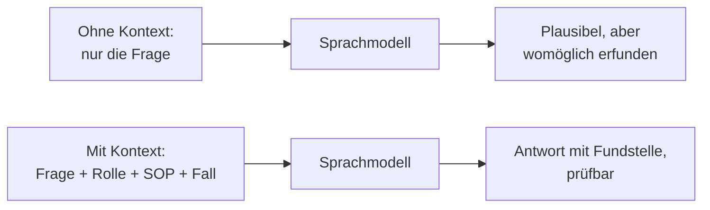
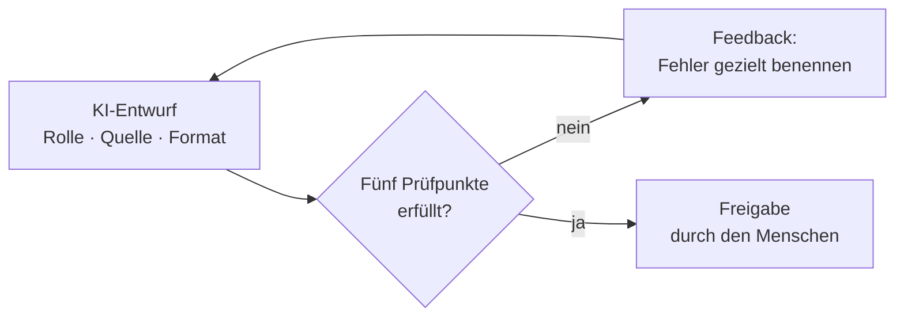

# Modul 1: Vom KI-Wildwuchs zum Agenten

Inhalt der Folien `s01` (Modul 1) in Stichpunkten. Lab 1.1 und Lab 1.2 sind Trainer-Showcase ohne Übung, Lab 1.3 ist die einzige Prompting-Übung des Tages.

## Lab 1.1: Vom KI-Wildwuchs zum Agenten

- KI-Wildwuchs: jede Person nutzt eigene Prompts, andere Tools, private Chats. Ergebnisse weichen ab, Quelle, Datenschutz und Nachvollziehbarkeit sind offen. Bei NC und CAPA ist das ein Qualitätsrisiko.
- Ein geteilter Agent ersetzt den Wildwuchs durch einen Standard: gleiche Quellen (NC-SOP, CAPA-SOP), geprüfte Skills, ein Owner, der pflegt und testet. Das Team arbeitet nach demselben Muster, die QS-Person prüft und entscheidet.

### Die Hebel-Leiter

| Stufe | Vorgehen | Wirkung |
| --- | --- | --- |
| 1 Frage | „Was soll ich tun?" | generische Antwort |
| 2 Rolle und Kontext | wer, wofür, für welchen Prozess | Antwort passt zur Aufgabe |
| 3 Dokumente | SOP und Fall als Quelle mitgeben | Antwort mit Fundstelle |
| 4 Ketten | jeder Schritt nutzt das Ergebnis des vorherigen | präzisere Ergebnisse als ein einzelner Prompt |
| 5 Agent | Rolle, Quellen und Ablauf dauerhaft gespeichert | wiederverwendbar und teilbar |

### Zielbild des Tages

| Block | Schritte |
| --- | --- |
| Vormittag: verstehen und konzipieren | Kontext und Prompting → Problem-Solver → Solution Architect → Skill-Generator |
| Nachmittag: zusammensetzen, prüfen, tunen | NC/CAPA-Agent → gegen Fälle prüfen → tunen → teilen und pflegen |

### Live-Demo: NC-02 zweimal an Copilot Chat

| | Prompt A | Prompt B |
| --- | --- | --- |
| Eingabe | nur die Meldung NC-02 und „Was soll ich tun?" | Rolle (QS nach Nordwind-NC-SOP), SOP-Auszug und Meldung als Quelle, Ausgabeformat vorgegeben |
| Erwartung | allgemeine Tipps ohne Bezug zur SOP | Antwort im SOP-Aufbau mit Quellenbezug |

## Lab 1.2: Wie KI lernt und Wissen speichert

| Begriff | Bedeutung |
| --- | --- |
| KI | Oberbegriff für Systeme, die Aufgaben lösen, die sonst Denken erfordern |
| LLM | Sprachmodell: erzeugt Text, indem es das wahrscheinlichste nächste Token vorhersagt |
| Generative KI | erzeugt neue Inhalte; eine Wahrscheinlichkeitsmaschine, keine Wahrheitsmaschine |

### Lernarten

| Lernart | Prinzip | QS-Beispiel |
| --- | --- | --- |
| Überwacht | Beispiele mit bekannter Lösung | Meldungen, die jemand als NC oder Nicht-NC eingestuft hat |
| Unüberwacht | Muster ohne vorgegebene Lösung | Häufungen in einer NC-Liste erkennen |
| Bestärkend | Belohnung und Strafe, auch durch Menschen | Bewertung von Antworten durch Menschen schärft das Modell |

### Wissen im Modell

| | Datenbank | Sprachmodell |
| --- | --- | --- |
| Speicherung | Fakten an einer Stelle | Gewichte und Verbindungen in Parametern |
| Abfrage | liefert genau den Eintrag | der Kontext aktiviert die passenden Verbindungen |
| Fehlt etwas | keine Antwort | Modell ergänzt Wahrscheinliches (Halluzination) |

**Live-Demo:** dieselbe Frage („Wann ist eine Abweichung eine CAPA?") ohne und mit angehängter SOP. Ohne SOP entstehen plausible, aber erfundene Kriterien; mit SOP nennt die Antwort den Abschnitt und lässt sich gegen das Dokument prüfen.

> **Merksatz:** Kontext ist alles: Ohne Quelle rät das Modell, mit Quelle lässt sich die Antwort prüfen.

**Leitfragen:**

Woher „weiß" ein Sprachmodell etwas?

Aus Mustern im Training, gespeichert als Gewichte. Es schlägt nichts nach, es rechnet Wahrscheinlichkeiten.

Warum klingt eine erfundene Antwort genauso sicher?

Das Modell erzeugt immer flüssigen Text. Sicherheit im Ton sagt nichts über Richtigkeit.

Was ändert ein angehängtes Dokument?

Die Antwort stützt sich auf die Quelle und lässt sich dagegen prüfen. Das Modell muss nicht raten.

## Lab 1.3: Prompten mit Mensch in the loop

### Copilot Chat im Arbeitsalltag

- Copilot antwortet aus dem, was mitgegeben wird: Text, angehängte Dateien, Verweise auf Dokumente.
- Kein Zugriff auf ERP, CAQ-System oder DMS. Daten bringt das Team mit.
- Datenregel: keine Patientendaten, keine personenbezogenen Daten, keine echten Nummern.

### Prompt-Bausteine

| Baustein | Bedeutung | Beispiel |
| --- | --- | --- |
| Rolle | wer die KI sein soll | QS-Mitarbeitende nach Nordwind-NC-SOP |
| Kontext | Fall, SOP-Auszug, Rahmenbedingungen | angehängte Meldung und NC-SOP |
| Aufgabe | was entstehen soll | Problembeschreibung nach A4.4 |
| Format | Tabelle, Felder, Länge wie in der SOP | Felder Soll, Ist, Differenz, Ort, Zeit, Objekt, Umfang, Entdeckung, Historie |

### QS-Zusätze für auditfeste Antworten

- Quellenbindung: nur aus Meldung und SOP antworten, Fundstelle nennen.
- Fakten, Annahmen und offene Punkte getrennt ausweisen.
- Nichts ergänzen, was nicht in der Quelle steht.
- Keine Ursache in der Problembeschreibung.

### Zero-Shot oder Few-Shot

| | Zero-Shot | Few-Shot |
| --- | --- | --- |
| Aufbau | nur die Anweisung | Anweisung plus ein Beispiel einer guten Problembeschreibung |
| Vorteil | schnell, gut für klare Standardaufgaben | Format und Detailtiefe folgen dem Muster |
| Nachteil | Format und Tonfall schwanken | das Beispiel muss zum Fall passen |

### Human in the Loop

### Die fünf Prüfpunkte

| Nr. | Prüfpunkt | Frage |
| --- | --- | --- |
| 1 | Quelle | Steht jede Aussage in Meldung oder SOP? |
| 2 | Nichts erfunden | Stimmen Zahlen, Daten und Namen wörtlich? |
| 3 | Getrennt | Sind Fakten, Annahmen und offene Punkte unterscheidbar? |
| 4 | Ursachenneutral | Enthält die Problembeschreibung keine Ursache? |
| 5 | Vollständig | Sind Soll, Ist, Ort, Zeit, Objekt und Umfang benannt? |

Die Karten mit den fertigen Prompts stehen in [`prompt-karten-hitl.md`](../project/prompt-karten-hitl.md).

## Fazit

- Wildwuchs wird durch einen geteilten Agenten mit gleichen Quellen und benanntem Owner ersetzt.
- Ein Sprachmodell rechnet Wahrscheinlichkeiten; erst der Kontext macht die Antwort prüfbar.
- Ein Beispiel (Few-Shot) legt Format und Detailtiefe fest, die fünf Prüfpunkte und gezieltes Feedback sichern die Qualität.

Anwendung in der Übung: [Lab 1.3](l03-prompting-human-in-the-loop/l03-prompting-human-in-the-loop-exc.md).
