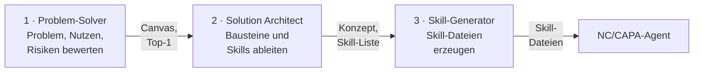
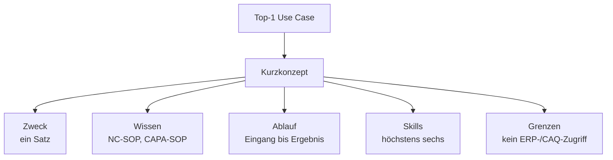

# Modul 2: KI baut KI – drei Assistenten

Inhalt der Folien `s01` (Modul 2) in Stichpunkten. Drei Übungen bauen aufeinander auf: Problem-Solver (Lab 2.1), Agentenkonzept (Lab 2.2), Skill-Dateien (Lab 2.3).

## Lab 2.1: Nextise Agentic Way und der Problem-Solver

**Ansatz:** Problem verstehen → Lösung konzipieren → bauen, der Mensch bleibt in jedem Schritt in the loop. Statt eines einzelnen Prompts übernimmt jeder von drei spezialisierten Assistenten das Ergebnis des vorherigen.



| Assistent | Eingabe | Ausgabe | Datei |
| --- | --- | --- | --- |
| 1 Problem-Solver | Problem in freien Worten | Use-Case-Canvas, Scoring, Top-1-Empfehlung | `agent/01-problem-solver.md` |
| 2 Solution Architect | Top-1-Empfehlung, NC-SOP, CAPA-SOP | Kurzkonzept, Skill-Liste, Ablauf, Übergabepaket | `agent/02-solution-architect.md` |
| 3 Skill-Generator | Konzept, SOP-Abschnitt, bewährter Prompt | fertige Skill-Datei und Testplan | `agent/03-skill-generator.md` |

### Der Problem-Solver zuerst

Er ist generisch, schnell gebaut und für jedes künftige Problem wiederverwendbar. Er stellt Rückfragen, statt sofort eine Lösung zu liefern.

| Canvas-Feld | Frage |
| --- | --- |
| 1 Problem | Welcher wiederkehrende Schritt im NC/CAPA-Prozess kostet Zeit oder schwankt in der Qualität? |
| 2 Zielgruppe | Wer ist betroffen, wie oft? |
| 3 Ist-Prozess | Wie läuft der Schritt heute in drei bis fünf Schritten, welcher SOP-Schritt ist es? |
| 4 Eingaben | Welche Informationen liegen beim Start vor? |
| 5 Gewünschtes Ergebnis | Was soll am Ende vorliegen? |
| 6 Datenlage | Was leistet der Agent aus Text und SOP, was beschafft ein Mensch aus ERP oder CAQ? |
| 7 Risiken | falsche oder erfundene Angaben, Auditfestigkeit, Datenschutz, Akzeptanz |

### Agent Builder in Copilot Chat

Klickpfad: Microsoft 365 Copilot Chat → **Neuer Agent** → **Konfigurieren** (bzw. „Skip to configure"). Bezeichnungen vor Kursbeginn im Tenant prüfen (Stand: Oktober 2026).

| Feld | Wofür | Beispiel Problem-Solver |
| --- | --- | --- |
| Name | wie der Agent heißt | Problem-Solver QS |
| Beschreibung | Zweck in einem Satz, auch für Kolleginnen und Kollegen | Hilft QS-Teams, ein Problem als Agent-Use-Case zu bewerten, bevor gebaut wird |
| Anweisungen | Rolle, Ablauf, Grenzen | Codeblock aus `agent/01-problem-solver.md` |
| Wissen | SOPs, Skill-Dateien, Vorlagen | `nordwind-sop-nc.md`, `nordwind-sop-capa.md` |
| Starter-Prompts | typische erste Eingaben | „Die Bearbeitung einer neuen NC dauert lange …" |

Hochgeladene Dateien sind je Agent auf 20 begrenzt (Microsoft Learn, aktualisiert am 30.09.2026; vor Kursbeginn prüfen).

Übung: [Lab 2.1](l01-build-problem-solver/l01-build-problem-solver-exc.md).

## Lab 2.2: Solution Architect

Vom Top-1-Use-Case zum Kurzkkonzept:



### Instruktion, Wissen oder Skill?

| Baustein | Gehört hinein | Beispiel |
| --- | --- | --- |
| Instruktion | Rolle, Ablauf, Grenzen | „Entscheidungen bleiben beim QS-Team." |
| Wissen | Dokumente zum Nachschlagen | NC-SOP, CAPA-SOP |
| Skill | wiederkehrende Aufgabe mit festem Format | Aufgabenplan zur Abweichungsanalyse |

### Referenzset der sechs Skills

| Nr. | Skill-Datei | SOP-Bezug | Leistung |
| --- | --- | --- | --- |
| 01 | `skill-01-nc-erstbewertung.md` | NC A4.1, A4.4 | Soll/Ist, NC-Einordnung, Problembeschreibung ohne Ursache |
| 02 | `skill-02-aufgabenplan-abweichungsanalyse.md` | NC A4.5 | Aufgaben je Pflichtfrage mit Datenquelle und Rolle |
| 03 | `skill-03-sofortmassnahmen.md` | NC A4.2, A4.7 | Isolation und Containment vorschlagen, getrennt von Korrektur |
| 04 | `skill-04-risiko-prioritaet-vorbereiten.md` | NC A4.6 | Worst Case, Fragen zur Schadensschwere, P1–P3-Logik |
| 05 | `skill-05-capa-eskalation-ursachenplan.md` | NC A4.9, CAPA B4.2–B4.3 | CAPA-Kriterien, Untersuchungsplan, 5-Why und Ishikawa |
| 06 | `skill-06-bearbeitung-pruefen.md` | NC A5, C5, CAPA B5 | Prüfung gegen Pflichtfragen und typische Fehler |

Übung: [Lab 2.2](l02-solution-architect/l02-solution-architect-exc.md).

## Lab 2.3: Skill-Generator

Eine Skill-Datei ist eine Markdown-Datei im Wissen des Agenten. Kopf und Gliederung der Referenzdatei `skill-01`:

```markdown
---
name: nc-erstbewertung
description: Bewertet eine neue NC-Meldung gegen die NC-SOP (Schritt 1 und 4) und erstellt eine
  ursachenneutrale Problembeschreibung mit Soll/Ist, verletzter Anforderung und NC-Einordnung.
  Verwenden, wenn eine Erstmeldung, Beobachtung oder Part 1 eines Falls eingeht.
version: 1.0
---
# Skill 01 – NC-Erstbewertung und Problembeschreibung
## Wann verwenden
## Eingaben
## Vorgehen
## Ausgabeformat
## Regeln und Grenzen
## Prüfhinweise für den Menschen
## SOP-Bezug
```

| Teil | Aufgabe |
| --- | --- |
| `name`, `description` | woran der Agent erkennt, wann der Skill passt |
| Wann verwenden | drei typische Nutzerfragen, dazu wann nicht, mit Verweis auf den zuständigen Skill |
| Eingaben, Vorgehen | was der Skill braucht und in welchen Schritten er arbeitet |
| Ausgabeformat | feste Struktur, damit Ergebnisse vergleichbar sind |
| Regeln und Grenzen | was beim Menschen bleibt (Entscheidung, Datenbeschaffung, Freigabe) |
| SOP-Bezug | welche SOP-Abschnitte gelten |
| `version` | wird bei jeder Änderung hochgezählt (Tuning, Lab 4.1) |

### Beschreibung eines Skills: schwach oder stark

| | Beispiel | Wirkung |
| --- | --- | --- |
| Schwach | „Hilft bei NCs." | kein Auslöser, kein Format; der Agent weiß nicht, wann er den Skill nutzen soll |
| Stark | „Bewertet eine neue NC-Meldung gegen NC-SOP Schritt 1 und 4 und erstellt eine ursachenneutrale Problembeschreibung." | nennt Auslöser, Quelle und Ergebnis |

### Aus Prompt und SOP wird ein Skill

| Schritt | Vorgehen |
| --- | --- |
| 1 | bewährten Prompt nehmen, z. B. den HITL-Prompt aus Lab 1.3 |
| 2 | SOP-Abschnitt ergänzen, z. B. NC-SOP A4.4 |
| 3 | Skill-Generator erzeugt die Datei nach dem Aufbau |
| 4 | Kurztest: Skill-Datei anhängen, an NC-02 Part 1 probieren |

**Leitfragen:**

<details>
<summary>Warum erst das Problem und nicht gleich den Agenten beschreiben?</summary>

Sonst entsteht ein Agent für das falsche Problem. Der Canvas zeigt, wo der Hebel wirklich liegt.

</details>

<details>
<summary>Woran erkennt der Agent, wann er einen Skill nutzen soll?</summary>

An Name und Beschreibung der Skill-Datei und an dem Hinweis in den Anweisungen, welcher Skill für welche Aufgabe gilt.

</details>

<details>
<summary>Welche Grenze muss jeder QS-Skill nennen?</summary>

Was beim Menschen bleibt: Entscheidung, Datenbeschaffung, Freigabe. Der Skill schlägt vor.

</details>

## Fazit

- Die Kette Problem-Solver → Solution Architect → Skill-Generator trennt Problem, Konzept und Umsetzung.
- Ein Agent besteht aus Anweisungen (Rolle, Ablauf, Grenzen), Wissen (SOPs, Skills) und Starter-Prompts.
- Ein Skill ist eine Aufgabe mit festem Format; seine Beschreibung entscheidet, ob er ausgelöst wird.

Anwendung in der Übung: [Lab 2.3](l03-skill-generator/l03-skill-generator-exc.md).
