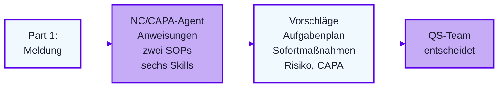

# Lab 3.1: Agent zusammensetzen

**Leitfragen:**

<details>
<summary>Welche Information gehört in die Instruktion, welche ins Wissen?</summary>

Die Instruktion enthält Rolle, Standardablauf, Grenzen und Stil: alles, was bei jeder Antwort gilt. Ins Wissen gehören SOPs und Skill-Dateien: Material, das nur bei Bedarf gelesen wird.

</details>

<details>
<summary>Wie zeigt der Agent, welche SOP-Stelle und welchen Skill er nutzt?</summary>

Die Instruktion verlangt in der ersten Zeile jeder Antwort die genutzten Skill-Dateien und für jede Aussage eine Quelle („Meldung“, „SOP <Abschnitt>“ oder „Annahme“).

</details>

- Der NC/CAPA-Agent entsteht im selben Agent Builder wie der Problem-Solver, jetzt mit Fachwissen und Skills.
- Das Gerüst liegt vorbereitet vor: eine Instruktion, zwei SOPs, sechs Referenz-Skills.

## Überblick



## Instruktion, Wissen, Skill

| Baustein | Inhalt | Wirkt | Änderung bei |
| --- | --- | --- | --- |
| Instruktion | Rolle, Standardablauf, Grenzen, Stil | bei jeder Antwort | Verhalten in allen Antworten |
| Wissen | `nordwind-sop-nc`, `nordwind-sop-capa` | als Quelle für Abschnittsnummern | neue SOP-Fassung |
| Skill | eine Aufgabe mit Vorgehen und Ausgabeformat | wenn die Anfrage zur Beschreibung passt | Verhalten bei einer Aufgabe |

## Das Gerüst: SOPs plus sechs Skills

Quelle: [`04-nordwind-nc-capa-agent.md`](../../project/agent/04-nordwind-nc-capa-agent.md), Skills in [`skills/`](../../project/agent/skills/).

| Skill | SOP-Bezug | Leistung des Agenten | Bleibt beim Menschen |
| --- | --- | --- | --- |
| 01 Erstbewertung | NC 1, 4 | Soll/Ist, Einordnung, Problembeschreibung | NC ja/nein |
| 02 Aufgabenplan | NC 5 | Aufgaben je Pflichtfrage mit Datenquelle und Rolle | Daten beschaffen, Umfang |
| 03 Sofortmaßnahmen | NC 2, 7 | Isolation und Containment vorschlagen | Umsetzen, genehmigen |
| 04 Risiko und Priorität | NC 6 | Worst Case, Fragen, P1–P3-Logik | Bewertung, Priorität |
| 05 CAPA-Eskalation | NC 9, CAPA 2–3 | Kriterien, Untersuchungsplan, 5-Why/Ishikawa | Ursache, Board |
| 06 Bearbeitung prüfen | NC A5, CAPA B5 | Prüft gegen Pflichtfragen und typische Fehler | Einwände entscheiden |

## Konfiguration im Agent Builder

Microsoft 365 Copilot Chat → Agent erstellen → Konfigurieren.

| Feld | Inhalt |
| --- | --- |
| Name | Nordwind-NC/CAPA-Assistent |
| Beschreibung | Bereitet NC- und CAPA-Vorgänge nach der Nordwind-SOP vor, entscheidet nichts |
| Anweisungen | Inhalt aus dem Codeblock der Gerüst-Datei, ca. 3.600 Zeichen |
| Wissen | 8 Dateien: zwei SOPs, `skill-01` bis `skill-06`, alle als `.md` |
| Funktionen | keine; Websuche aus, Antworten nur aus Wissen und Eingabe |
| Starter-Prompts | vier Einträge, z. B. „Neue NC vorbereiten“ |

Stand 19.10.2026, vor Kursbeginn prüfen: Feldgrenze der Anweisungen 8.000 Zeichen, höchstens 20 Dateien als Wissen, Upload von `.md` möglich (Quelle: Microsoft Learn „Add knowledge sources to an agent in Agent Builder“).

## Die Instruktion: Auszug mit Anmerkungen

```text
# Wissen
- Maßgeblich sind die Dateien "Prozessbeschreibung NC" (NC-SOP) und "Prozessbeschreibung CAPA" (CAPA-SOP). Zitiere Abschnittsnummern.   <- Quellenbindung
- Für jede Aufgabe gibt es eine Skill-Datei. Lies die passende Skill-Datei und halte dich an deren Vorgehen und Ausgabeformat:   <- Routing
  - Was ist zu tun, welche Daten fehlen, Umfang → skill-02-aufgabenplan-abweichungsanalyse
- Nenne am Anfang jeder Antwort in einer Zeile, welche Skill-Datei(en) du nutzt.   <- sichtbar, welcher Skill greift

# Grenzen
- Du hast KEINEN Zugriff auf ERP, CAQ-System, DMS oder Labordaten. ...   <- Aufgaben statt Ergebnisse
```

Der Standardablauf bei einer neuen Meldung: Erstbewertung → Sofortmaßnahmen → Aufgabenplan → Risiko und Priorität → Hinweis zur CAPA-Eskalation.

## Fazit

- Instruktion steuert alle Antworten, Skills steuern je eine Aufgabe, SOPs liefern die Quelle.
- Der eigene Skill aus Lab 2.3 ersetzt oder ergänzt die Referenz-Skill-Datei.
- Smoke-Test: Standardablauf und sichtbare Skill-Zeile in der ersten Antwort.

Die Übung setzt den Agenten aus dem Gerüst zusammen und testet ihn mit NC-02 Part 1.
