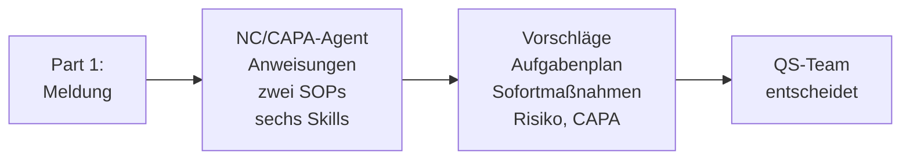
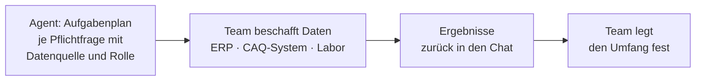
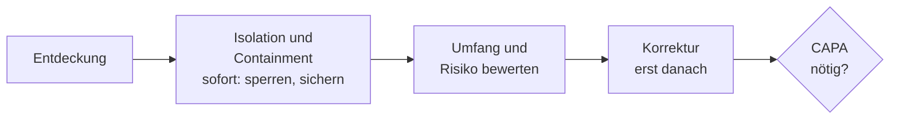

# Modul 3: Der konkrete Use Case – Agent zusammensetzen und prüfen

Inhalt der Folien `s02` (Modul 3) in Stichpunkten. Lab 3.1 und Lab 3.3 sind Übungen, Lab 3.2 ist Trainer-Showcase ohne Übung.

## Lab 3.1: Agent zusammensetzen

Derselbe Agent Builder wie beim Problem-Solver, jetzt mit Fachwissen und Skills.

### Das Gerüst: Felder des Agenten

Quelle: `project/agent/04-nordwind-nc-capa-agent.md`.

| Feld | Inhalt |
| --- | --- |
| Name | Nordwind-NC/CAPA-Assistent |
| Beschreibung | bereitet NC- und CAPA-Vorgänge nach der Nordwind-SOP vor; entscheidet nichts |
| Anweisungen | Codeblock der Datei (Rolle, Wissen, Standardablauf, Grenzen, Prüfregeln, Stil) |
| Wissen (8 Dateien) | `nordwind-sop-nc.md`, `nordwind-sop-capa.md`, `skill-01` bis `skill-06` |
| Funktionen | keine; Websuche aus, damit Antworten nur aus Wissen und Eingabe stammen |
| Starter-Prompts | „Neue NC vorbereiten", „Was ist zu tun?", „CAPA und 5-Why", „Bearbeitung prüfen" |

Neu hochgeladene Dateien zeigen zunächst den Status „Preparing". Der Agent nutzt sie erst, wenn der Status wechselt. Eigene Skill-Dateien aus Lab 2.3 werden unter dem Namen der Referenzdatei hochgeladen und ersetzen sie, weil die Anweisungen die Skills per Dateiname aufrufen.

### Skills mit Verantwortung des Menschen

| Skill | SOP-Bezug | Leistung des Agenten | Bleibt beim Menschen |
| --- | --- | --- | --- |
| 01 Erstbewertung | NC 1, 4 | Soll/Ist, Einordnung, Problembeschreibung | NC ja/nein |
| 02 Aufgabenplan | NC 5 | Aufgaben je Pflichtfrage mit Datenquelle und Rolle | Daten beschaffen, Umfang |
| 03 Sofortmaßnahmen | NC 2, 7 | Isolation und Containment vorschlagen | Umsetzen, genehmigen |
| 04 Risiko und Priorität | NC 6 | Worst Case, Fragen, P1–P3-Logik | Bewertung, Priorität |
| 05 CAPA-Eskalation | NC 9, CAPA 2–3 | Kriterien, Untersuchungsplan, 5-Why/Ishikawa | Ursache, Board |
| 06 Bearbeitung prüfen | NC A5, CAPA B5 | Prüft gegen Pflichtfragen und typische Fehler | Einwände entscheiden |

### Standardablauf bei einer neuen Meldung

| Teil | Inhalt | Skill |
| --- | --- | --- |
| 1 | Erstbewertung und Problembeschreibung | 01 |
| 2 | Sofortmaßnahmen | 03 |
| 3 | Aufgabenplan für Abweichungsanalyse und Umfang | 02 |
| 4 | Vorbereitung Risiko und Priorität | 04 |
| 5 | Hinweis zur CAPA-Eskalation (nur Teil A) | 05 |

Jede Antwort nennt in der ersten Zeile die genutzte Skill-Datei und endet mit offenen Punkten und dem Hinweis „Vorschlag – Prüfung und Entscheidung durch die zuständige Rolle".

### Prüfregeln des Agenten (NC-SOP C4)

| Bedingung | Folge |
| --- | --- |
| keine Anforderung referenziert | keine abschließende NC-Klassifizierung |
| Produkt potenziell außerhalb der Kontrolle | Gesundheitsrisiko-Pfad und SiBa/QP-Beteiligung prüfen |
| Schadensschwere S3 oder höher | HHE (Gesundheitsrisikobewertung) durch SiBa verlangen |
| hohes regulatorisches Compliance-Risiko | P1 vorschlagen bzw. fachliche Bestätigung anfordern |
| P1 | CAPA verpflichtend |
| P2 | wiederkehrend, systemisch, FSN/FSCA prüfen; Entscheidung des CAPA Boards |
| potenzielle NC | P3 und Vorbeugemaßnahme prüfen |

Übung: [Lab 3.1](l01-assemble-agent/l01-assemble-agent-exc.md).

## Lab 3.2: Der Agent am Kundenfall (Showcase)

Der Trainer zeigt den Agenten in drei Läufen:

| Lauf | Fall | Gezeigt wird |
| --- | --- | --- |
| 1 | NC-03 Druckmessdosen | Aufgabenplan und Sofortmaßnahmen, Abgleich mit der realen Bearbeitung |
| 2 | NC-02 Stückzahl | CAPA-Eskalation und 5-Why für Auftreten und Entdeckung |
| 3 | Agenten-Output mit Fehlern | Prüfung live mit den fünf Prüfpunkten ([`agenten-output-mit-fehlern.md`](../project/agenten-output-mit-fehlern.md)) |

### Aufgabenplan statt ERP-Zugriff

Pflichtfragen der Umfangsbestimmung (NC-SOP A4.5): Zeitraum, letzte konforme Ausführung, betroffene Chargen und Lose, gemeinsame Ursachenquellen, Prüfmittel.

### Isolation, Containment, Korrektur, CAPA-Maßnahme

| Art | Zweck | Beispiele |
| --- | --- | --- |
| Isolation | betroffene Elemente sofort nicht weiterverwenden | Sperrlager, Statussperre, Kennzeichnung „nicht verwenden" |
| Containment | gesamten Umfang kontrollieren, bis Konformität hergestellt ist | Auslieferungsstopp, Sortierung, 100-%-Prüfung |
| Korrektur | betroffene Elemente konform machen oder genehmigt verwenden/verwerfen | Nacharbeit, Sonderfreigabe, Verschrottung |
| CAPA-Maßnahme | Ursache beseitigen, Wiederauftreten verhindern | Prozessänderung, Prüfplanänderung |

### CAPA: drei Ursachenketten

| Kette | Frage | Beispiel NC-02 |
| --- | --- | --- |
| Auftreten | Warum entstand die Abweichung? | Warum steht im Dienstleister-Protokoll 201 statt 200? |
| Entdeckung | Warum wurde sie nicht früher erkannt? | Warum fiel sie in AG 150 nicht auf? |
| System | Warum ließ der Prozess das zu? | Welche Prüfung fehlt im Ablauf? |

Der Agent strukturiert und prüft. Die Antwort auf jedes „Warum" liefert das Team.

### 5-Why und Ishikawa mit dem Agenten

- 5-Why: jede Antwort mit Prüfstatus (belegt, Annahme, offen), nie die erste Antwort als Ursache.
- Ishikawa 6M in Textform: Mensch, Maschine, Methode, Material, Messung, Mitwelt; je Faktor bestätigt, ausgeschlossen oder offen.
- Keine Ursachenfindung durch die KI: der Agent liefert das Gerüst und die offenen Fragen.
- „Mitarbeiterfehler" ist keine abschließende Ursache; „Schulung" nur bei nachgewiesenem Wissensdefizit.

### Typische Fehlerbilder in Agenten-Antworten

| Fehlerbild | Woran man es erkennt |
| --- | --- |
| Stille Ergänzung | Zahl, Datum oder Charge steht nicht in der Meldung |
| Ursache in der Problembeschreibung | Schuldzuweisung statt Beobachtung |
| Containment als Korrektur | Sperren wird als Behebung geführt |
| Schulung als Standard-CAPA | Maßnahme ohne nachgewiesenes Wissensdefizit |
| Zu enger Umfang | nur das gemeldete Los, keine Prüfung weiterer Chargen |

**Leitfragen:**

Woran erkennt man einen zu engen Umfang?

Nur das gemeldete Los wird betrachtet. Zeitraum, letzte konforme Ausführung und gemeinsame Ursachenquellen fehlen.

Warum braucht es eine eigene Kette für die Entdeckung?

Die Ursache der Abweichung und die Ursache der Nicht-Entdeckung sind verschieden. Nur beide zusammen schließen die Lücke.

Ist „Charge sperren" Containment oder Korrektur?

Containment bzw. Isolation. Eine Korrektur folgt erst nach Umfang und Risikobewertung.

## Lab 3.3: Agentenprüfung

Ein Agent wird getestet wie jede andere Arbeitsmethode: mit einem Fall, dessen Ergebnis bekannt ist.

| Schritt | Vorgehen |
| --- | --- |
| 1 Testfall | nur Part 1 des Falls in den Agenten geben |
| 2 Antwort sichern | unverändert speichern |
| 3 Referenz | `kernschritte-referenz.md` (und bei Bedarf Part 2/3) öffnen |
| 4 Bewerten | Bewertungsbogen ausfüllen, zwei schwächste Punkte markieren |

### Bewertungsraster

| Kriterium | Prüffrage |
| --- | --- |
| Vollständigkeit | Sind alle SOP-Pflichtfragen abgedeckt? |
| Treffer | Entspricht der Vorschlag der realen Bearbeitung? |
| Datenqualität | Zahlen, Daten und Nummern korrekt, nichts erfunden? |
| Maßnahmen | Containment und Korrektur getrennt? |
| Priorität | begründet statt behauptet? |
| Grenzen | Agent schlägt vor, statt zu entscheiden? |

Der Agent kennt nur Part 1. Treffer zählen deshalb Aufgaben und Fragen, die er aus Part 1 ableiten kann, nicht die Ergebnisse, die erst das Team ermittelt hat.

## Fazit

- Der Agent verbindet SOPs, Skills und Anweisungen; der Mensch beschafft Daten und entscheidet.
- Isolation, Containment, Korrektur und CAPA-Maßnahme bleiben getrennt.
- Ein Agent wird gegen reale Bearbeitungen getestet: nur Part 1 hinein, Antwort sichern, dann mit der Referenz vergleichen.

Anwendung in der Übung: [Lab 3.3](l03-agent-evaluation/l03-agent-evaluation-exc.md).
